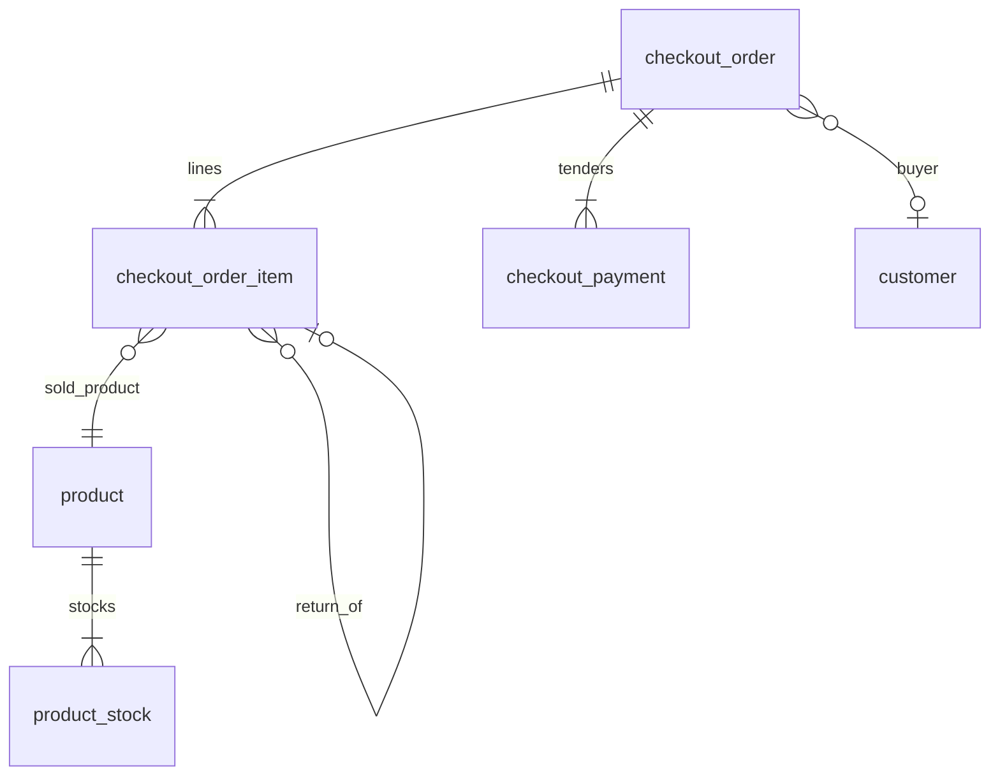

# Transactions — Data Model

Three new tables. Product and customer tables stay as they are. Checkout reads `product`, updates `product_stock.quantity` for location `store`, and updates `customer.total_spent`.

Snake_case columns. JSON is camelCase, as in the API contract.

## ER sketch

`customer_id` is nullable, **`ON DELETE SET NULL`**. Name and phone snapshots are required to remain. `product_id` is **`ON DELETE RESTRICT`** so a sale line cannot lose its catalog link. Return lines reference another line by id, not by product id alone.

## Table: `checkout_order`

| Column | Type | Notes |
|--------|------|--------|
| `id` | `String` PK | `ord-{uuid4}` no dashes |
| `order_number` | `String` UNIQUE | `SO-YYYYMMDD-####` |
| `idempotency_key` | `String` UNIQUE, nullable | From the header. Null when the client omits it. |
| `branch_id` | `String` | `branch-store` or `branch-online`. No branch table. |
| `branch_name` | `String` | `台北旗艦店` or `官網`, copied from `branch_id` |
| `cashier_id` | `String` | Snapshot of the current user id. No staff table. |
| `cashier_name` | `String` | Snapshot of the current user name |
| `status` | `String` | `completed`, `partially_refunded`, `refunded` |
| `customer_id` | `String` FK nullable | `customer.id`, `ON DELETE SET NULL` |
| `customer_name` | `String` nullable | Snapshot at commit |
| `customer_phone` | `String` nullable | Snapshot. Canonical phone, or null. |
| `items_subtotal` | `Integer` | |
| `discount_amount` | `Integer` | Line list-versus-charged gap only. Not the points discount. |
| `shipping_fee` | `Integer` | ≥ 0 |
| `total_amount` | `Integer` | Merchandise + shipping − points discounts. Floor at 0 only when the gross amount is ≥ 0. Refunds stay negative. |
| `invoice_number` | `String` | Required. Unique among sales. A refund stores the original sale's number again, so several rows may share it. A ticket cannot mix a sale line and a return line. History search matches this column. |
| `invoice_type` | `String` | `none`, `carrier`, `tax_id`, `paper` |
| `carrier_code` | `String` nullable | |
| `tax_id` | `String` nullable | |
| `buyer_title` | `String` nullable | Invoice title, not the member name |
| `note` | `Text` nullable | |
| `business_date` | `Date` | `Asia/Taipei` calendar date of `created_at`. Used for the order number and day reports. |
| `created_at` | `DateTime` TZ | Server UTC. Sale datetime. |
| `updated_at` | `DateTime` TZ | Insert time, then return-driven status changes |

Indexes: unique `order_number`, `invoice_number` (not unique), unique `idempotency_key`, `customer_id`, `business_date`, `created_at`, `status`, `branch_id`.

## Table: `checkout_order_item`

| Column | Type | Notes |
|--------|------|--------|
| `id` | `String` PK | `oli-{uuid4}` no dashes |
| `order_id` | `String` FK | `ON DELETE CASCADE` |
| `line_no` | `Integer` | 1-based order of the request items |
| `product_id` | `String` FK | `ON DELETE RESTRICT` |
| `sku` | `String` | Snapshot |
| `name` | `String` | Snapshot |
| `scale` | `String` | Snapshot |
| `brand` | `String` | Snapshot |
| `original_price` | `Integer` | List price at commit |
| `unit_price` | `Integer` | Charged price, ≥ 0 |
| `cost_price` | `Integer` | `product.cost_price` at commit. Not in the JSON contract. |
| `is_manual_price` | `Boolean` | |
| `price_diff_reason` | `Text` nullable | |
| `quantity` | `Integer` | Not zero |
| `subtotal` | `Integer` | `unit_price * quantity`, before the points discount |
| `points_discount_applied` | `Boolean` | Not null. Default `false`. True when this product used one points exchange on this sale. |
| `points_discount_amount` | `Integer` | `360` when applied, otherwise `0`. Kept on the line so a later offer change does not rewrite old sales. |
| `returned_quantity` | `Integer` | Default `0`. Only increases through a later return order. |
| `pre_order_id` | `String` nullable | Pickup. No preorder CRUD in this phase. |
| `pre_order_item_id` | `String` nullable | |
| `original_order_id` | `String` nullable | Return |
| `original_order_item_id` | `String` FK nullable | `checkout_order_item.id`, `ON DELETE RESTRICT` |
| `restock` | `Boolean` nullable | Meaningful when `quantity < 0` |
| `return_reason` | `Text` nullable | |

Unique `(order_id, line_no)`. Index `product_id`, `original_order_item_id`, `pre_order_item_id`.

A return line and a sale line for the same product are different rows. Matching a return to "the line with this product id" is not enough when one order sold the product twice (a normal line and a preorder pickup). Callers use `originalOrderItemId`.

## Table: `checkout_payment`

| Column | Type | Notes |
|--------|------|--------|
| `id` | `String` PK | `pay-{uuid4}` no dashes |
| `order_id` | `String` FK | `ON DELETE CASCADE` |
| `line_no` | `Integer` | 1-based |
| `type` | `String` | Payment method union. `cod` is not inserted. |
| `name` | `String` | |
| `amount` | `Integer` | |
| `tendered_cash` | `Integer` nullable | |
| `change_amount` | `Integer` nullable | Server-computed for cash |
| `transaction_ref` | `String` nullable | |

Unique `(order_id, line_no)`.

## Stock write

Only `product_stock` where `location = 'store'` changes.

| Line | Effect |
|------|--------|
| `quantity > 0` | Subtract `quantity`. Row lock. Reject if the locked quantity is short. |
| `quantity < 0` and `restock` is true | Add `abs(quantity)`. |
| `quantity < 0` and `restock` is false | No stock change. |

`warehouse`, `company`, and `other` are untouched. The counter may warn that the shelf is short of the cart; the server still refuses the commit when `store` cannot cover the positive lines. Branch on the order does not select a different stock row.

## Member spending

When `customer_id` is set, in the same transaction:

`total_spent = max(0, total_spent + total_amount)`

Catalog create still starts `total_spent` at `0`. Catalog `PUT` still must not accept it.

## Points discount

There is no points balance on `customer`. Points are checked by the cashier outside the system.

On commit, for each positive line with `points_discount_applied`:

- That line records `points_discount_amount = 360`.
- The same `product_id` cannot be redeemed twice on one order.
- Quantity does not add more exchanges.
- The sale does not read or update any points column.
- A later return of that product refunds `unit_price` only. The original line keeps `points_discount_applied` and `points_discount_amount`. The return line stores both as false and 0.

`total_amount` floors at 0 only when merchandise plus shipping is already zero or more and the points discounts would push it negative. A return whose merchandise total is negative stays negative.

## Preorder pickup write

When a line has both preorder ids, the same transaction adds `quantity` to that preorder item's `qty_delivered` and recomputes the preorder status. This phase does not create preorders, record arrivals, or cancel them. Those columns are owned by the preorder module; checkout is the writer of `qty_delivered` at pickup.

Status after the increment:

| Condition | Status |
|-----------|--------|
| Every item `qty_arrived = 0` | `pending` |
| Every item `qty_delivered = qty_ordered` | `completed` |
| Any item `qty_delivered > 0` | `partially_completed` |
| Otherwise | `partially_arrived` |

## What is not a table

- Open cart, highlighted row, search box text, brand tab. Frontend only.
- `vipTierName` and `totalStock`. Derived on read.
- A points balance. The NT$360 flag is only a record of the discount the cashier applied.
- A branch or cashier entity. The two branch ids are fixed labels. Cashier stays a snapshot of the current user.
