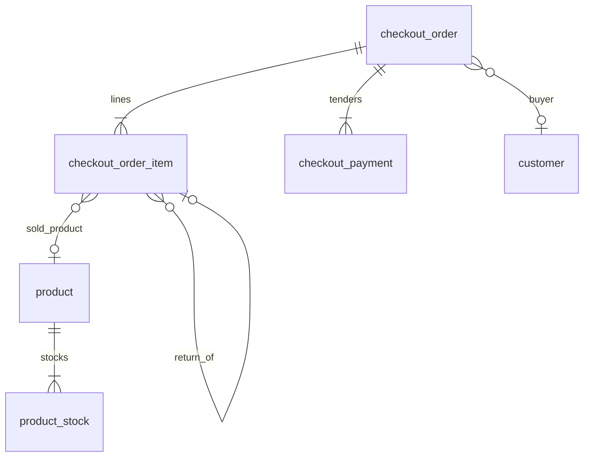

# Transactions — Data Model

Three new tables. Product and customer tables stay as they are. Checkout reads `product`, updates `product_stock.quantity` for location `store`, and updates `customer.total_spent`.

Snake_case columns. JSON is camelCase, as in the API contract.

## ER sketch

`customer_id` is nullable, **`ON DELETE SET NULL`**. Name and phone snapshots are required to remain. `product_id` is required, **`ON DELETE RESTRICT`**. A catalog product is not deleted. `product.deleted` hides it from the counter and leaves the row, so a sale line's `product_id` stays filled. The line still keeps its sku, name, scale, and brand snapshots. A return line points at the earlier sale line it is giving product back from, and its `product_id` must equal that sale line's `product_id`. The service must not skip that comparison.

## Table: `checkout_order`

| Column | Type | Notes |
|--------|------|--------|
| `id` | `String` PK | `ord-{uuid4}` no dashes |
| `order_number` | `String` UNIQUE | `SO-YYYYMMDD-HHMMSS-####`. Date and clock are `Asia/Taipei`. `####` is the max suffix for that second, plus 1. The per-second prefix is the concurrency control. There is no retry when two sales share a second. |
| `idempotency_key` | `String` UNIQUE, nullable | From the header. Null when the client omits it. A unique conflict is caught, then the winning row is re-selected and replayed. |
| `branch_id` | `String` | `branch-store` or `branch-online`. No branch table. |
| `branch_name` | `String` | `台北旗艦店` or `官網`, copied from `branch_id` |
| `cashier_id` | `String` | Snapshot of the current user id. No staff table. |
| `cashier_name` | `String` | Snapshot of the current user name |
| `status` | `String` | `completed`, `partially_refunded`, `refunded` |
| `customer_id` | `String` FK nullable | `customer.id`, `ON DELETE SET NULL` |
| `customer_name` | `String` nullable | Snapshot at commit |
| `customer_phone` | `String` nullable | Snapshot. Canonical phone, or null. |
| `items_subtotal` | `Integer` | Sum of line `subtotal` |
| `discount_amount` | `Integer` | Manual list-versus-charged gap only. Not the points discount. |
| `shipping_fee` | `Integer` | ≥ 0 |
| `total_amount` | `Integer` | Sum of line subtotals + shipping. Points are not subtracted again here, and this column is not floored for points. A ticket may mix sale lines and return lines, so the total may be positive, zero, or negative. |
| `note` | `Text` nullable | |
| `business_date` | `Date` | `Asia/Taipei` calendar date of `created_at`. Used for the order number and day reports. |
| `created_at` | `DateTime` TZ | Server UTC. Sale datetime. |
| `updated_at` | `DateTime` TZ | Insert time, then return-driven status changes |

There is no invoice. No `invoice_number`, `invoice_type`, carrier, tax id, or buyer title.

Indexes: unique `order_number`, unique `idempotency_key`, `customer_id`, `business_date`, `created_at`, `status`, `branch_id`.

## Table: `checkout_order_item`

| Column | Type | Notes |
|--------|------|--------|
| `id` | `String` PK | `oli-{uuid4}` no dashes |
| `order_id` | `String` FK | `ON DELETE CASCADE` |
| `line_no` | `Integer` | 1-based order of the request items |
| `product_id` | `String` FK | Required. `ON DELETE RESTRICT`. The product row stays; `product.deleted` is the hide flag. |
| `sku` | `String` | Snapshot |
| `name` | `String` | Snapshot |
| `scale` | `String` | Snapshot |
| `brand` | `String` | Snapshot |
| `original_price` | `Integer` | List price at commit |
| `unit_price` | `Integer` | Charged price. When `points_discount_applied` is true, this is the frontend price already reduced by 360. The server does not change it again. |
| `is_manual_price` | `Boolean` | |
| `price_diff_reason` | `Text` nullable | |
| `quantity` | `Integer` | Not zero. Positive sells. Negative returns product from an earlier sale line. |
| `subtotal` | `Integer` | `unit_price * quantity`. If a points reduction would make this negative, store **0**. That floor is on this line, not on `checkout_order.total_amount`. A return line stays negative. |
| `points_discount_applied` | `Boolean` | Not null. Default `false`. True when this product used one points exchange on this sale. |
| `points_discount_amount` | `Integer` | `360` when applied, otherwise `0`. Kept on the line so a later offer change does not rewrite old sales. Not subtracted again from `total_amount`. |
| `returned_quantity` | `Integer` | Default `0`. Only increases when a later line returns units from this sale line. |
| `original_order_id` | `String` nullable | The earlier checkout order this line is returning product from. Null on a sale line. Set when `quantity < 0`. |
| `original_order_item_id` | `String` FK nullable | The earlier sale line whose units this line is returning. `checkout_order_item.id`, `ON DELETE RESTRICT`. Null on a sale line. |
| `restock` | `Boolean` nullable | Meaningful when this line is returning product (`quantity < 0`) |
| `return_reason` | `Text` nullable | Why those units are being returned |

There is no `cost_price`. There are no preorder columns.

Unique `(order_id, line_no)`. Index `product_id`, `original_order_item_id`.

A return line and a sale line for the same product are different rows. Matching a return to "the line with this product id" is not enough when one order sold the product twice. Callers use `original_order_item_id`, the sale line the units are being returned from.

## Table: `checkout_payment`

| Column | Type | Notes |
|--------|------|--------|
| `id` | `String` PK | `pay-{uuid4}` no dashes |
| `order_id` | `String` FK | `ON DELETE CASCADE` |
| `line_no` | `Integer` | 1-based |
| `type` | `String` | `cash`, `credit_card`, `line_pay`, `bank_transfer`, or `cod`. `cod` is not inserted. |
| `name` | `String` | Display name from the tender. |
| `amount` | `Integer` | |
| `tendered_cash` | `Integer` nullable | Cash notes received. |
| `change_amount` | `Integer` nullable | |
| `transaction_ref` | `String` nullable | Card last-4 or transfer last-5. |

Unique `(order_id, line_no)`.

## Stock write

Only `product_stock` where `location = 'store'` changes.

| Line | Effect |
|------|--------|
| `quantity > 0` | Subtract `quantity`. The commit is not refused when the locked quantity is short. `store` may go below zero. |
| `quantity < 0` and `restock` is true | Add `abs(quantity)` for the units being returned. |
| `quantity < 0` and `restock` is false | No stock change. |

`warehouse`, `company`, and `other` are untouched. The counter shows a warning popup when the shelf looks short. The cashier decides whether there is actually product to sell. The server trusts that decision and still commits. The recorded stock count may be inaccurate. Branch on the order does not select a different stock row.

## Member spending

When `customer_id` is set, in the same transaction:

`total_spent = max(0, total_spent + total_amount)`

Catalog create still starts `total_spent` at `0`. Catalog `PUT` still must not accept it.

## Points discount

There is no points balance on `customer`. Points are checked by the cashier outside the system.

On commit, for each positive line with `points_discount_applied`:

- The frontend already reduced `unit_price` by 360. The server stores that `unit_price` and does not subtract 360 again.
- That line records `points_discount_amount = 360` as a fact about the sale. It is not applied a second time to `total_amount`.
- The same `product_id` cannot be redeemed twice on one order.
- Quantity does not add more exchanges.
- The sale does not read or update any points column.
- Line `subtotal` is `unit_price * quantity`. If the points reduction would make that subtotal negative, `subtotal` is **0**. This floor is per line. `total_amount` is the sum of those subtotals plus shipping, with no further points floor.
- A later return of that product refunds the stored `unit_price` only. The original line keeps `points_discount_applied` and `points_discount_amount`. The return line stores both as false and 0.

## What is not a table

- Open cart, highlighted row, search box text, brand tab. Frontend only.
- `vipTierName` and `totalStock`. Derived on read.
- A points balance. The NT$360 flag is only a record of the discount the cashier applied. The price cut itself is already in `unit_price`.
- A branch or cashier entity. The two branch ids are fixed labels. Cashier stays a snapshot of the current user.
- An invoice, a cost price, or a preorder.
