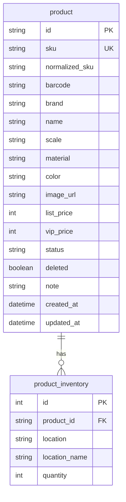

# Products Catalog — Data Model

Persistence design for catalog endpoints. Tables: `product`, `product_inventory`. Response DTO maps snake_case DB → camelCase JSON to match FE / OpenAPI `Product`.

## ER sketch

---

## Table: `product`

Catalog metadata only. **Does not** store `total_inventory`.

| Column | Type (suggested) | Constraints / notes |
|--------|------------------|---------------------|
| `id` | `VARCHAR` / `String` PK | Opaque `prod-{uuid4}` without dashes; seed may use `prod-001` style |
| `sku` | `String` | **UNIQUE**, required |
| `normalized_sku` | `String` | Server-maintained; same rules as FE `normalizeSku` |
| `barcode` | `String` | Required; **not** unique |
| `brand` | `String` | |
| `name` | `String` | |
| `scale` | `String` | Enum values: `1:18`, `1:43`, `1:64`, `1:24`, `1:12`, `配件周邊` |
| `material` | `String` nullable | |
| `color` | `String` nullable | |
| `image_url` | `String` nullable | → JSON `imageUrl` |
| `list_price` | `Integer` | TWD ≥ 0 → `listPrice` |
| `vip_price` | `Integer` nullable | TWD ≥ 0 → `vipPrice` |
| `status` | `String` | Not null. `active` or `deleted`. Default `active`. This is the soft-delete record. `deleted` hides the product. `active` restores it. The row is never removed. |
| `deleted` | `Boolean` | Not null. Default `false`. Mirrors `status`: `true` only when `status` is `deleted`. |
| `note` | `Text` / `String` nullable | |
| `created_at` | `DateTime` TZ | Server set on insert |
| `updated_at` | `DateTime` TZ | Server set on insert/update |

### Indexes / uniqueness

| Index | Columns | Unique? | Purpose |
|-------|---------|---------|---------|
| PK | `id` | yes | |
| UK | `sku` | yes | Duplicate SKU → API conflict |
| IX | `barcode` | **no** | Keyword search by barcode (confirmed) |
| IX | `normalized_sku` | no (optional) | Faster SKU-contains keyword search |
| IX | `brand` | no (optional) | Brand filter |
| IX | `created_at` / `sku` | — | Default list sort `sku ASC` |

**Confirmed:** `barcode` is **not** unique — multiple products may share a barcode; keyword search may return multiple rows.

---

## Table: `product_inventory`

One row per product per location. Catalog create **always inserts** all four locations at **`quantity: 0`** (no client quantities on `POST /products`).

| Column | Type (suggested) | Constraints / notes |
|--------|------------------|---------------------|
| `id` | `Integer` PK / serial | Surrogate key |
| `product_id` | `String` FK → `product.id` | `ON DELETE RESTRICT`. Product rows are not deleted. |
| `location` | `String` | `store` \| `warehouse` \| `company` \| `other` |
| `location_name` | `String` | Fixed display map (門市現貨 / 後方倉庫 / 公司總倉 / 調度暫存) |
| `quantity` | `Integer` | ≥ 0; default `0` |

### Indexes / uniqueness

| Index | Columns | Unique? | Purpose |
|-------|---------|---------|---------|
| UK | `(product_id, location)` | yes | One row per location |
| IX | `product_id` | no | Load stocks for a product |

Catalog **PUT** must not change these rows. Stock mutations belong to future `/inventory/*` APIs.

---

## Server-computed response fields

Not stored on `product`:

| API field | Computation |
|-----------|-------------|
| `totalInventory` | `SUM(product_inventory.quantity)` for the product (missing rows treated as absent; create always ensures four rows) |
| `normalizedSku` | Stored on `product.normalized_sku` but always derived from `sku` on write (`upper` + strip non `[A-Z0-9]`); never trust client |
| `inventories` | Assembled from `product_inventory` rows → camelCase `LocationInventory[]` |

---

## ORM / module map (planned, not implemented)

| Piece | Path |
|-------|------|
| Models | `src/models/product.py` (or split `product_inventory`) |
| Schemas | `src/schemas/product.py` |
| Service | `src/services/product_service.py` |
| Endpoints | `src/api/v1/endpoints/products.py` |
| Router | `src/api/v1/api.py` |
| Migration | `alembic/versions/…` |

Register models in `src/models/__init__.py` / `src/db/base.py` so Alembic autogenerate sees them.

---

## Alembic notes

1. First revision: **schema only** — all three tables + indexes/constraints above (no seed data).
2. Prefer explicit FK + unique constraints in migration (not only ORM).
3. **Seed later (decision B):** Alembic data migration and/or management script — insert `product` + four `product_inventory` rows per item. See [`04-open-questions.md`](./04-open-questions.md).
4. `created_at` / `updated_at`: use timezone-aware UTC; update `updated_at` in service on metadata PUT.

---

## Mapping cheatsheet (DB → JSON)

| DB | JSON |
|----|------|
| `normalized_sku` | `normalizedSku` |
| `image_url` | `imageUrl` |
| `list_price` | `listPrice` |
| `vip_price` | `vipPrice` |
| `location_name` | `locationName` |
| (computed) | `totalInventory` |
